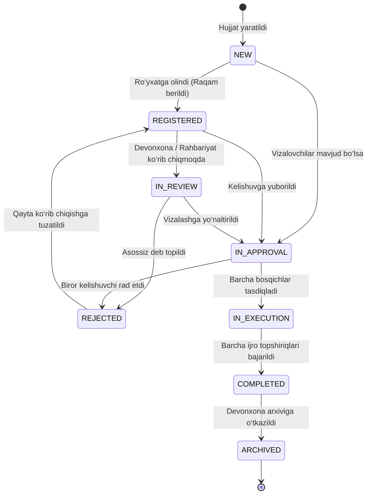

# ShortDoc — Tizim Arxitekturasi va Xavfsizlik Modeli

## 1. Umumiy Ma'lumot
**ShortDoc** — Oliy ta’lim muassasalarida (Sharof Rashidov nomidagi Samarqand davlat universiteti) kiruvchi, chiquvchi va ichki hujjatlarni (xizmat xatlari, bildirishnomalar, buyruq loyihalari) boshqarish hamda topshiriqlar ijrosini nazorat qilish uchun mo‘ljallangan xavfsiz va markazlashgan elektron hujjat aylanishi tizimi.

---

## 2. Loyiha Tuzilmasi (Repository Structure)
```text
shortdoc/
├── backend/                  # Express + Prisma 5 + PostgreSQL + Zod + JWT REST API
│   ├── prisma/               # Schema va SQL migratsiyalar (prisma/migrations/)
│   ├── src/
│   │   ├── app.ts            # Express ilovasi, middlewarelar va routing
│   │   ├── server.ts         # HTTP server, cron va graceful shutdown
│   │   ├── config.ts         # Zod orqali qat'iy tekshiriluvchi konfiguratsiya
│   │   ├── routes/           # REST API yo'nalishlari
│   │   ├── services/         # Access control (RBAC/IDOR), Realtime SSE, Ticket, Cron
│   │   ├── middleware/       # Auth, Rate limiting, Error handler, Audit
│   │   └── utils/            # JWT, docxGenerator, excelGenerator, response
│   └── tests/                # Vitest + Supertest integratsion testlar
├── frontend/                 # Next.js 15 (App Router, React 19, Tailwind CSS)
│   ├── src/app/              # Next.js sahifalari
│   ├── src/components/       # Modulli UI komponentlari (Auth, Documents, Users)
│   ├── src/context/          # AuthContext, RealtimeContext, ThemeContext
│   └── src/lib/              # api.ts (fetchApi), downloadDocx.ts
├── nginx/                    # Nginx reverse proxy va SSE konfiguratsiyasi
├── docs/                     # Arxitektura va deployment qo'llanmalari
├── docker-compose.yml        # Multi-container production orkestratsiyasi
└── README.md                 # Ishga tushirish qo'llanmasi
```

---

## 3. Ruxsatlar Matritsasi (RBAC / IDOR Matrix)

| Endpoint / Resurs | SUPER_ADMIN | LEADERSHIP | CHANCELLERY | DEPARTMENT_HEAD | STAFF |
|---|---|---|---|---|---|
| **GET /documents (barchasi)** | ✅ Barchasi | ✅ Barchasi | ✅ Barchasi | 🔶 O‘z bo‘limi + o‘zi aloqador | 🔹 Faqat o‘zi yaratgan/biriktirilgan/viza |
| **GET /documents/:id** | ✅ Barchasi | ✅ Barchasi | ✅ Barchasi | 🔶 O‘z bo‘limi + aloqador | 🔹 Faqat o‘ziga tegishli (IDOR himoya) |
| **POST /documents** | ✅ | ✅ | ✅ | ✅ | ✅ |
| **PATCH /documents/:id/status** | ✅ | ✅ | ✅ | 🔶 O‘z bo‘limi hujjatlari | ❌ Taqiqlangan (403) |
| **POST /documents/:id/approvals**| 🔶 O‘z navbatida | 🔶 O‘z navbatida | 🔶 O‘z navbatida | 🔶 O‘z navbatida | 🔶 O‘z navbatida |
| **POST /tasks (yaratish)** | ✅ | ✅ | ✅ | 🔶 Hujjat doirasida | ❌ Faqat hujjat egasi bo‘lsa |
| **PATCH /tasks/:id/status** | ✅ | ✅ | ❌ | 🔶 O‘z bo‘limi topshiriqlari | 🔹 Faqat o‘ziga biriktirilgan topshiriq |
| **POST /tasks/:id/submit-result**| ❌ | ❌ | ❌ | 🔹 Faqat ijrochi bo‘lsa | 🔹 Faqat biriktirilgan ijrochi |
| **GET /document-files/:id/download**| ✅ | ✅ | ✅ | 🔶 Ruxsati bo‘lgan hujjat | 🔹 Faqat ruxsati bo‘lgan hujjat |
| **DELETE /document-files/:id** | ✅ | ❌ | ❌ | ❌ | 🔹 Faqat o‘zi yuklagan bo‘lsa |
| **GET /users (ro‘yxat)** | ✅ To‘liq (Email/Tel) | ✅ To‘liq | ✅ To‘liq | ✅ To‘liq | 🔹 Cheklangan (Email/Tel yashirilgan) |
| **PATCH /users/:id/approve** | ✅ | ❌ | ❌ | ❌ | ❌ |
| **GET /audit-logs** | ✅ | ❌ | ❌ | ❌ | ❌ |
| **GET /reports/dashboard** | ✅ Umumiy SamDU | ✅ Umumiy SamDU | ✅ Umumiy SamDU | 🔶 Bo‘lim statistikasi | 🔹 Shaxsiy vazifalar statistikasi |

---

## 4. Hujjat Holatlari State Machine (Lifecycle Diagram)

Hujjatlar o‘zboshimchalik bilan holat sakrashidan qat’iy himoyalangan (`backend/src/services/access.ts` ichida `isValidStatusTransition` tekshiruvi orqali).



---

## 5. Xavfsizlik va Ma’lumotlar Butunligi Modeli

1. **Parol va Sessiya Xavfsizligi:**
   - Parol siyosati: kamida 8 ta belgi (ro‘yxatdan o‘tish va ma’muriy qo‘shishda).
   - `User.tokenVersion`: Foydalanuvchi parolini yangilaganda yoki sessiyasini bekor qilganda, `tokenVersion` qiymati inkrement qilinadi. Barcha eski JWT tokenlar darhol 401 Unauthorized holatiga tushadi.

2. **Poyga Holatlaridan Himoya (Race Conditions):**
   - Hujjat ro‘yxat raqamlari atomik `DocumentCounter` jadvali va tranzaksiyalar (`prisma.$transaction`) orqali `lastNumber: { increment: 1 }` bilan shakllantiriladi. Parallel kelgan o‘nlab so‘rovlar hech qachon bir xil raqam olmaydi.

3. **Fayllar Xavfsizligi:**
   - Fayl yuklashda `file-type` kutubxonasi orqali fayl mazmuni (magic bytes) tekshiriladi.
   - Soxta kengaytmali fayllar (masalan, ichi HTML bo‘lgan `.pdf` yoki skriptlar) aniqlanib, darhol rad etiladi.
   - Fayllar yuklab olinganda `X-Content-Type-Options: nosniff` va RFC 5987 spetsifikatsiyasiga muvofiq xavfsiz sarlavhalar beriladi.

4. **SSE (Real-time) Xavfsizligi:**
   - Bildirishnomalar oqimi (`/api/notifications/stream`) tokenlarni URL query parametri sifatida loglarga sizdirilishidan himoyalangan: uning o‘rniga 30 soniyalik, bir martalik `stream-ticket` tizimi ishlaydi.

5. **Tarmoq Xavfsizligi:**
   - PostgreSQL porti (`5432`) tashqi tarmoqqa yopiq;
   - Helmet CSP (Content Security Policy) yoqilgan;
   - CORS whitelist (`CORS_ORIGIN`);
   - Express Rate Limiting (login, register, check-email va global so‘rovlar).
